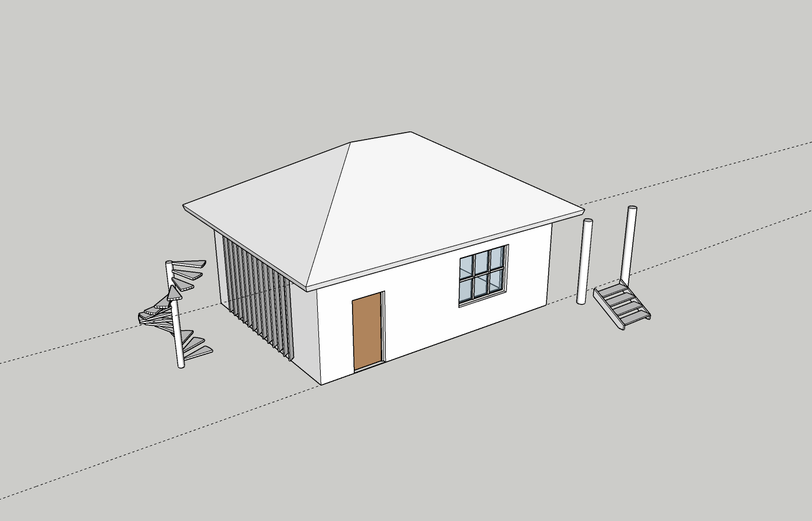
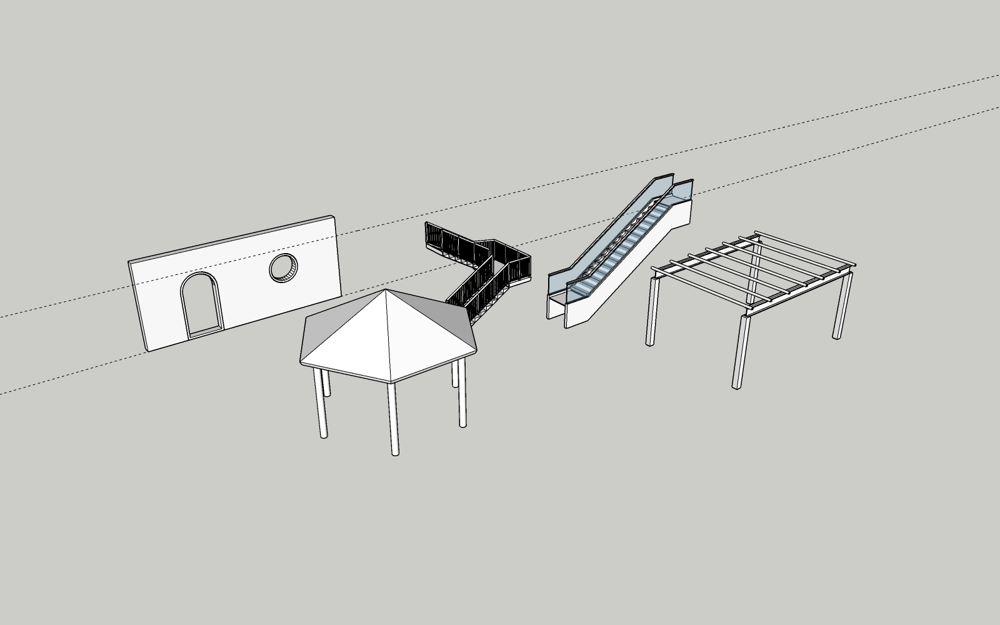
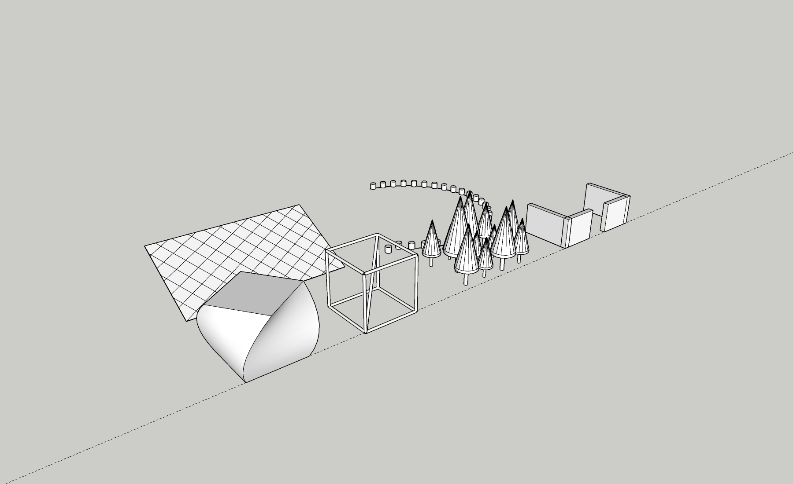
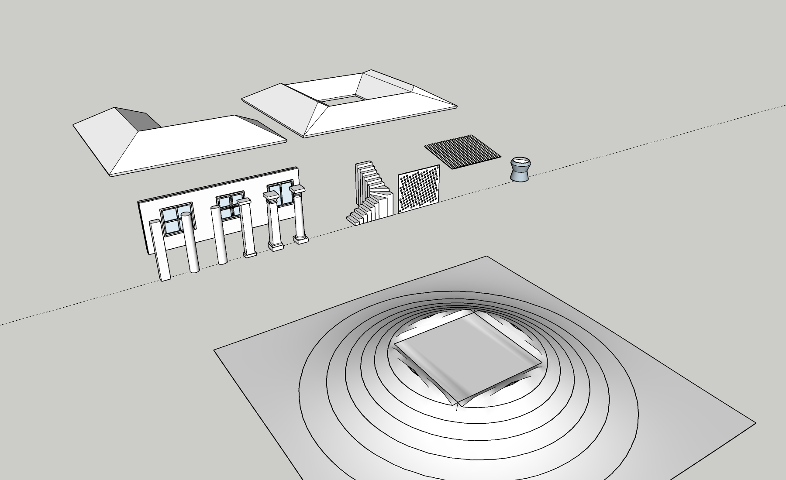

# ArchiTools

Плагин SketchUp 2024 для архитектурного моделирования. Это переосмысление
заброшенного 1001bit Tools, написанное с нуля.

Версия 0.3.1 · лицензия [Apache 2.0](LICENSE) · © 2026 B&A community

Создатели: maksarsanjeev — см. [AUTHORS](AUTHORS)









## Что делает

Все 40 функций 1001bit Tools (по оглавлению руководства автора, версия Pro),
все 47 команд JHS Powerbar 2020.1 (по файлам самого плагина) и собственные
инструменты — всего 74 инструмента в восьми категориях. У каждого есть
панель параметров, а результат укладывается в один шаг отмены. Сверка с обоими
оригиналами по каждой функции и протокол проверок лежат в
[docs/TESTING.md](docs/TESTING.md): 40 из 40 функций 1001bit, 47 из 47 команд
JHS, 183 из 183 живых проверок в SketchUp 2024.

| Категория | Инструменты |
|---|---|
| **Рёбра и точки** | Скругление, фаска, продление (до пересечения или до плоскости), деление ребра (на N частей, с шагом от начала или от середины, «шаг не больше»; разрезы, точки или точки в серединах), точка центра, смещение цепочки рёбер, уклон рёбер (угол, 1:N, перепад; можно оставить исходные рёбра), перпендикуляр к грани; по кликам: точка на грани по расстояниям, перпендикуляр к ребру или грани, грань на плоскости по 3 точкам, грань по неплоским точкам, перемещение вершины, выравнивание по 3 точкам |
| **Правка** | Выдавить много граней, выдавить с сохранением сужения, сдвиг граней по нормали, оболочка, профиль по пути без закручивания, сечение из библиотеки по пути (круг, трубы, двутавр, швеллер, уголок, тавр), тело вращения (с масштабом и подъёмом — спирали, рога), горизонтальный разрез граней, горизонтальные бороздки и выступы, массивы — линейный, прямоугольный, круговой, по пути; выравнивание и распределение объектов |
| **Стены и проёмы** | Стена по линиям: сплошная, с воздушной прослойкой, перегородка со стойками, по своему сечению (парапет, карниз, лоток), вертикальная на наклонной линии. Проём прямоугольный, арочный, круглый или по нарисованному контуру, с коробкой по откосам. Окно: глухое, створчатое или раздвижное, рама простая, с четвертью или с наличником, перед гранью, посередине или за ней. Дверь одно- и двупольная |
| **Фасад** | Ламели семи профилей (плоская, лист, овальная, труба, короб, швеллер, каплевидная) перед гранью, по ней или за ней; разбивка на панели с рамой; перфорированный экран (круглые или прямоугольные отверстия, поворот сетки, отступ); профнастил (трапеция, волна, короб) по грани любой формы |
| **Лестницы** | Прямой марш (по плите, сплошной, на двух косоурах, на центральном косоуре), с площадкой (Г и П, налево и направо), с забежными ступенями, винтовая, эскалатор 30°/35°; ограждения — стойки, поручень, балясины, ригели или стекло — у маршей и отдельным инструментом по любым рёбрам. Лестницы ставятся кликом |
| **Каркас и кровля** | Балки перекрытия, стропила (с лобовой доской), прогоны и обрешётка — любого сечения из библиотеки, по контуру грани любой формы; кровля: вальмовая по контуру любой формы, включая Г, Т, П и внутренние дворы (прямой скелет), двускатная и односкатная по прямоугольнику, со свесом и толщиной; колонны: прямоугольная, круглая, эллиптическая, с базой и капителью, тосканская квадратная и круглая; фундаменты столбчатый и ленточный; балки по рёбрам |
| **Рельеф** | Площадка со срезкой и подсыпкой (откосы под заданным углом, объёмы в м³), перенос контура на рельеф, горизонтали |
| **Моделирование** (как JHS Powerbar) | Сглаживание рёбер (по углу, все, снять, четырёхугольники), сварить рёбра, распустить кривые, равные сегменты, найти грани, опустить на поверхность или отметку, точки в вершины, соединить точки, компонент в точки, зеркало по 2–3 кликам, поворот вокруг оси, случайный масштаб и поворот, сдвиг на вектор, Rotix (поворот стрелками), прокси компонентов, замена компонентов, сетка на грани, Split Up, FFD — деформация решёткой 3×3×3, 4×4×4 или своей с фиксацией рёбер. Плюс в «Правке»: выдавить линии, линии в трубы; у профиля по пути — своя вертикаль (вектор или ребро), у смещения — вывод направляющими, у массивов — «бусы» и шахматный порядок, у выравнивания — к общему центру выделения |

Отказ всегда объясняет причину («Радиус не помещается на рёбрах; наибольший —
612 mm»). Если причина в выделении, плагин пишет, что нужно выделить.

## Управление

- **Панель ArchiTools** (Расширения → ArchiTools → Панель, или первая кнопка
  панели инструментов). Наверху статус показывает, что сейчас выделено. Ниже
  идут вкладки категорий, кнопки инструментов, подсказка «что выделить» и
  параметры. Поля, которые не относятся к выбранному режиму, скрыты. Кнопка
  «Применить» (или Enter в поле) запускает инструмент.
- **Инструменты с кликами** (точка на грани, перпендикуляр, грани по точкам,
  перемещение вершины, выравнивание по 3 точкам, ось тела вращения) после
  «Применить» ждут кликов в модели с обычными привязками SketchUp. Подсказка
  в строке состояния говорит, какую точку указать. Enter или двойной клик —
  готово, Backspace — убрать последнюю точку, Esc — отмена.
- **Кнопки категорий** на панели инструментов открывают панель на этой
  категории.
- **Пункты меню** Расширения → ArchiTools → <категория> → <инструмент>
  запускают инструмент сразу, с последними параметрами. На них можно повесить
  горячие клавиши SketchUp.
- **Расстановка кликом** для лестниц, одиночной колонны и фундамента: объект
  едет за курсором с привязками. Tab или ←/→ поворачивают его на 90°, клик
  ставит, Esc убирает.
- Длины вводятся в единицах модели: можно писать `1200`, `1,2м`, `4'6"`.
  Параметры запоминаются для каждого инструмента отдельно.
- Открытая цепочка рёбер считается идущей от конца с меньшим X (затем Y).
  Так «слева / справа» у стен и фундаментов и сторона смещения не зависят от
  того, в каком порядке SketchUp хранит рёбра.

## Чем отличается от 1001bit Tools

| | 1001bit Tools | ArchiTools |
|---|---|---|
| Ввод | Модальные окна на каждый инструмент | Одна немодальная панель на всё; работа по выделению, клики — где без них нельзя |
| Предустановки | «Save settings» в Pro | Последние значения помнятся для каждого инструмента |
| Окна и двери | По одному проёму | В выбранный проём, а если выделить стену — во все её прямоугольные проёмы сразу |
| Кровля | Вальма по любому контуру | То же; скелет проверен на 16 контурах, включая звезду и кривой двор |
| Рельеф | Срезка и подсыпка | То же, плюс объёмы срезки и подсыпки в сообщении |
| Моделирование | Отдельный плагин JHS Powerbar — сборник чужих скриптов разных авторов и лицензий | Те же 47 команд, написанные заново в одном стиле, с проверками; случайные преобразования воспроизводимы по «зерну» |
| Отмена | Как получится | Каждое применение даёт ровно один шаг отмены, а отказ откатывает всё |
| Языки | Английский | Русский и английский пакеты |

Где оригинал описан только картинками, мы не знаем точных вариантов.
Двенадцать типов лестниц в руководстве показаны без текста; у нас семь
видов маршей. Профили ламелей, стропил, обрешётки и профнастила сделаны по
общепринятым сечениям, а не по рисункам 1001bit. Сечение «по своей грани»
(Setup Profile) есть у стен и у проёмов; у ламелей, балок и экрана вместо
него библиотека сечений.

## Статус

0.3.1 — тестовая сборка. Релиза нет, готовый пакет не выкладывается.
Собирается локально и раздаётся напрямую.

## Установка

Расширения → Менеджер расширений → Установить расширение →
`architools-0.3.1-rus.rbz` (или `-eng.rbz`). После установки или обновления
перезапустите SketchUp — меню и панель инструментов строятся при запуске.

Для разработки: `powershell -ExecutionPolicy Bypass -File dev_install.ps1`
копирует `src\` в Plugins SketchUp 2024 (`-Version 2025` — в другую версию).

## Структура

```
src/architools.rb                регистратор (SketchupExtension)
src/architools/
  main.rb                        меню, панель инструментов, запуск из меню
  constants.rb lang.rb           версия, категории; словари ru/en
  registry.rb                    каталог инструментов, параметры, запуск, клики
  geom.rb                        цепочки рёбер, оси грани, сечения, триангуляция, сдвиг вершин
  profiles.rb                    библиотека сечений, брус и проводка сечения по пути
  skeleton.rb                    прямой скелет многоугольника с дырами (вальма)
  terrain.rb                     рельеф: высота в точке, сшивка горизонталей
  ffd.rb                         FFD: решётка, многочлены Бернштейна, наблюдатель
  place_tool.rb pick_tool.rb     расстановка кликом и сбор точек кликами
  panel.rb about.rb icons.rb     окна и иконки
  tools/edges.rb points.rb modify.rb surfaces.rb walls.rb facade.rb
        railing.rb stairs.rb framing.rb site.rb modeling.rb
  html/                          panel.html, about.html, ba.css, ba.js, i18n.js
  icons/                         SVG-иконки панели инструментов
tools/build_rbz.ps1              сборка пакетов
dev_install.ps1                  установка в SketchUp для разработки
test/                            живые тесты через MCP-мост, офлайн-проверки, отчёт
```

Новый инструмент добавляется одним `Registry.define(:id, :category) { |p| … }.run { |ctx| … }`
(для кликов — `.picks(count:, prompts:)` перед `.run`) и строками
`tool_id` / `hint_id` / `p_…` в `lang.rb`. Панель и меню строятся по
каталогу сами.

## Сборка

```
powershell -ExecutionPolicy Bypass -File tools\build_rbz.ps1          # обе сборки
powershell -ExecutionPolicy Bypass -File tools\build_rbz.ps1 -Lang en # только английская
```

Пакеты появятся в `dist\architools-<версия>-rus.rbz` и `-eng.rbz`.

## Проверка

- `ruby test/check_lang.rb` проверяет офлайн, что у ru и en одинаковые ключи
  и что у всех инструментов, параметров, режимов и подсказок кликов есть
  подписи.
- `ruby test/check_skeleton.rb` проверяет офлайн прямой скелет кровли на 16
  контурах (Г, Т, П, крест, звезда, дворы). Площадь скатов должна совпадать с
  площадью контура, а каждый скат — быть плоским.
- `python test/bridge.py test/live_tools.rb` гоняет 183 проверки в живом
  SketchUp через MCP-мост (`127.0.0.1:8080`): функциональные для каждого из
  74 инструментов, отказ на пустом выделении, одна отмена, однозначность
  направления, путь через клики, контроль покрытия. Всё строится во
  временной группе-песочнице, и остальная модель не трогается.
  `ARCHITOOLS_ONLY=<регулярка>` гоняет только часть проверок.
- `python test/make_report.py <вывод прогона>` пересобирает
  [docs/TESTING.md](docs/TESTING.md) — сверку с 40 функциями 1001bit и 47
  командами JHS Powerbar и протокол всех проверок.
- Пока идёт прогон, окно SketchUp лучше не трогать: клик выводит из
  песочницы, и тест останавливается (модель при этом не трогается).
- `test/live_demo.rb` … `live_demo4.rb` строят демо-сцены и
  сохраняют снимки вида.
- После `dev_install.ps1` код перезагружается без перезапуска SketchUp:
  `python test/bridge.py test/reload.rb`.

## Грабли

- **Тест чистит только свою песочницу.** Однажды прогон вышел из группы-
  песочницы (клик в окне SketchUp закрывает открытую группу), а очистка шла
  по «активному контексту» — им стал корень модели, и тест стёр чужие
  объекты. Теперь очистка идёт по `@sandbox.entities`, а перед каждым шагом
  проверяется, что контекст — песочница; иначе прогон останавливается.
- Порядок выделения у SketchUp случайный: всё, что зависит от порядка
  (случайные преобразования по «зерну»), сначала сортируется по положению.

- `Length#<` в SketchUp сравнивает с допуском 0,001″: `0.to_l < 0.0001`
  даёт `false`. Расстояния и длины векторов перед сравнением приводим к
  `Float`.
- `Entities#transform_by_vectors` неверно двигает вершины кривых (дуг,
  окружностей): кривые распускаются, сдвиг идёт, потом они свариваются
  обратно (`Geom3.move_vertices`).
- `add_line` не режет встречные рёбра. Поэтому сетку на грани рисуем
  отрезками между пересечениями, иначе грань не разделится.
- Неплоский многоугольник `PolygonMesh` SketchUp молча выбрасывает, и в теле
  остаётся дыра, а «веер» из одной вершины у вогнутого многоугольника
  вылезает наружу. Такие многоугольники режем отсечением ушей
  (`Geom3.triangulate`).
- После склейки соседних треугольников одной плоскости остаются висячие
  рёбра без граней — их надо убирать, иначе на площадке видна штриховка.
- Скругление сначала строит дугу, а уже потом удаляет угловые куски. Тогда
  исходная грань сохраняется, а отваливается только уголок.
- `add_face` поверх грани стены может развернуть её остаток изнанкой
  наружу. После пробивки проёма нормали этой плоскости возвращаются.
- Порядок рёбер в цепочке SketchUp не гарантирует: всё, что зависит от
  направления, приводится к однозначному (`Geom3.canonical`).
- Прямой скелет: время удара входящего угла в чужое ребро считается по
  скорости сближения `1 − v·n`. При одновременных событиях сначала
  выполняется разрез, иначе встречные параллельные рёбра сливаются в вершину
  без направления.
- Внутри открытой группы координаты в Ruby API мировые: чтение и запись в
  активном контексте согласованы, но трансформация группы на них не влияет.

## Лицензия

[Apache 2.0](LICENSE) · © 2026 B&A community. Код 1001bit Tools не
использовался: оригинал закрыт и не распространяется, а повторено только
поведение по руководству автора и открытым описаниям.
